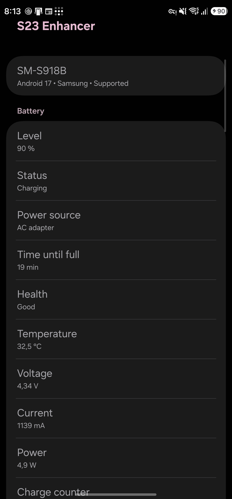
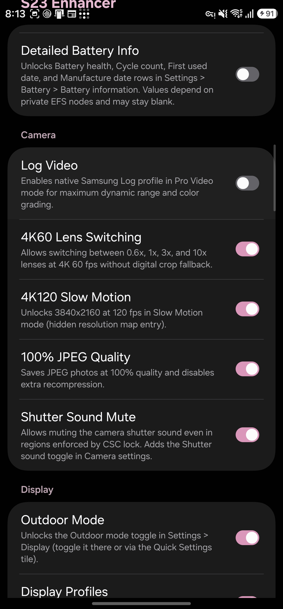
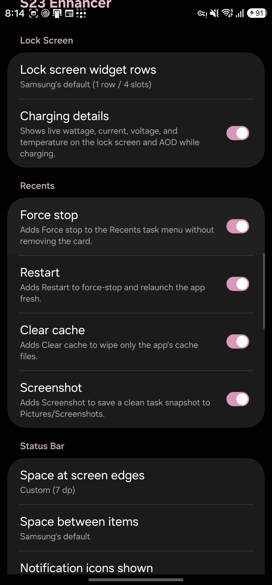
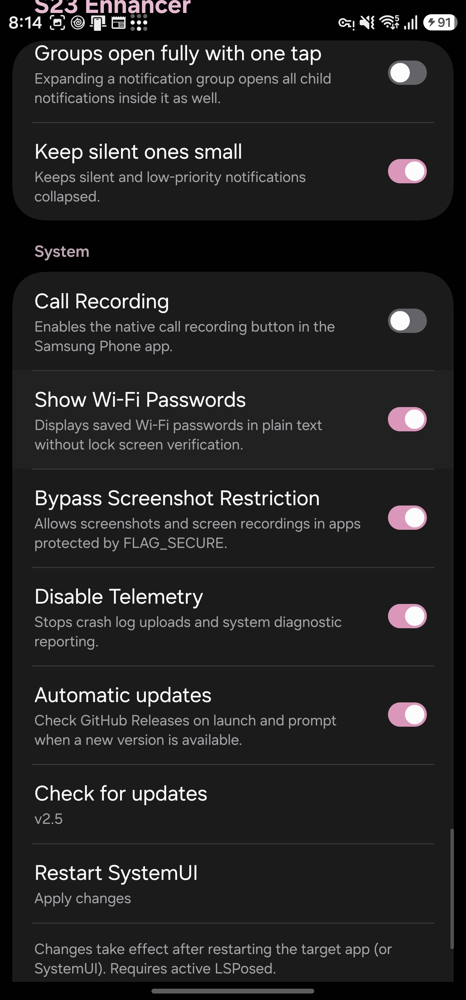
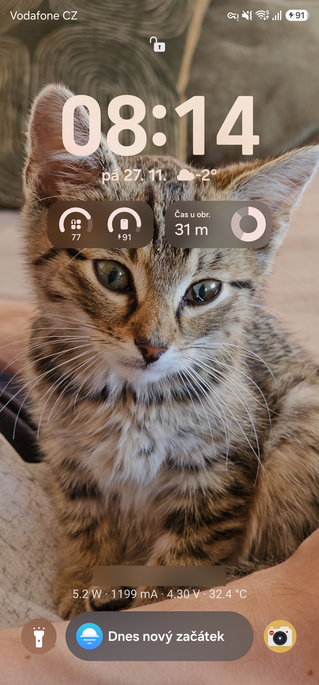
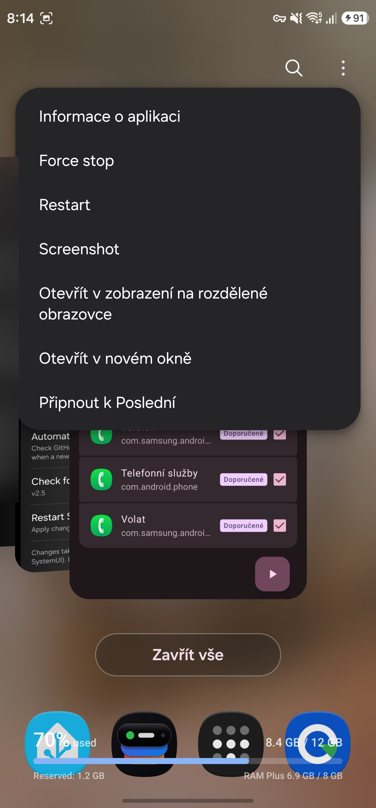

# S23 Enhancer (LSPosed)

Also check out [Galaxy AI Offline Speech-to-Text & Diarization Module](https://github.com/FoxxoOwO/galaxyai-offline-stt)

LSPosed module + companion app built with native **SESL9 (Samsung One UI 9)** components for the **Galaxy S23 Ultra** (SM-S918B, One UI 9 / Android 16–17).

The module unlocks features that Samsung has software-locked on the S23 and adds SystemUI / Status Bar customizations. Each feature can be individually toggled or configured inside the companion app without requiring a device reboot.

> **Do NOT reboot the device** if you are using tethered root (KernelSU / volatile jailbreak) — rebooting will result in losing root access. After toggling a setting, either `force-stop` the target app or tap **Restart SystemUI** directly in the app.

## Screenshots

<table>
  <tr>
    <td align="center"><br /><sub>Live Battery card</sub></td>
    <td align="center"><br /><sub>Camera &amp; Display tweaks</sub></td>
    <td align="center"><br /><sub>Lock Screen, Recents &amp; Status Bar</sub></td>
  </tr>
  <tr>
    <td align="center"><br /><sub>Notifications, System &amp; Updates</sub></td>
    <td align="center"><br /><sub>Lock Screen widgets &amp; charging details</sub></td>
    <td align="center"><br /><sub>Recents task menu actions</sub></td>
  </tr>
</table>

## Features

| Area | Features & Preference Keys |
| :--- | :--- |
| **Camera** | Log Video (`pref_camera_log_video`), 4K60 lens switching (`pref_camera_4k60_lenses`), 4K120 Slow Motion (`pref_camera_4k120_slowmo`), 100% JPEG quality (`pref_camera_jpeg_100`), Shutter sound mute toggle (`pref_camera_shutter_mute`), Skip post-processing for stills (`pref_camera_skip_postproc`, also exposed as a **Skip post-processing** switch inside the Camera app settings) |
| **Display** | Outdoor Mode toggle (`pref_display_outdoor_mode` + Quick Settings tile), Display color profiles (`pref_display_screen_mode`: AMOLED Cinema / Photo / Basic), Extended screen timeouts (`pref_display_screen_timeout`: 30 min / 1 hr / Never), Action timeout (`pref_display_action_timeout`), Adaptive Color Tone (`pref_display_adaptive_color_tone`), Unlock custom fonts (`pref_display_unlock_fonts`) |
| **Lock Screen** | Multi-row lock screen widget grid (`pref_lockscreen_widget_rows`: Samsung's default 1 row / 4 slots, 2 rows / up to 8 widgets, or 3 rows / up to 12 widgets), Live charging details on lock screen & AOD (`pref_lockscreen_charging_info`: `W · mA · V · °C`) |
| **Recents** | Configurable Recents task menu items (`pref_recents_force_stop`, `pref_recents_restart`, `pref_recents_clear_cache`, `pref_recents_screenshot`) |
| **Status Bar** | Screen edge spacing (`pref_sb_edge_space_mode`, `pref_sb_edge_space_dp`), Item spacing (`pref_sb_item_spacing`), Max notification icons `1–10` (`pref_sb_max_notif_icons`), Hidden status icons via `icon_blacklist` (`pref_sb_hidden_icons`), One connection icon (`pref_sb_one_connection_icon`), Status bar Back button (`pref_sb_back_button`), Screen burn-in pixel shift (`pref_sb_burn_in_protect`), Network speed meter (`pref_sb_net_speed`, `pref_sb_net_speed_mode`, `pref_sb_net_speed_auto_hide`) |
| **Status Bar Taps** | Double-tap empty space to sleep (`pref_sb_double_tap_sleep`), Tap vibration + strength (`pref_sb_tap_vibrate`, `pref_sb_tap_vibrate_strength`), Customizable tap & long-press actions (including Camera and Open any app) with live Test button (`pref_sb_tap_*` / `pref_sb_long_*` for Battery, Clock, Front camera hole, Wi-Fi, Mobile signal) |
| **Notifications** | Open notifications fully (`pref_notif_auto_expand`), Expand groups with one tap (`pref_notif_expand_groups_one_tap`), Keep silent notifications small (`pref_notif_keep_silent_small`) |
| **System & Updates** | Native call recording (`pref_telephony_call_recording`), Show Wi-Fi passwords (`pref_system_show_wifi_passwords`), Bypass `FLAG_SECURE` (`pref_system_disable_flag_secure`), Disable telemetry (`pref_system_disable_telemetry`), App info package & install date (`pref_system_app_info_details`), Improve fingerprint accuracy (`pref_system_fp_improve_accuracy`), Detailed battery info (`pref_system_battery_info`), Live Battery card, Restart SystemUI button, GitHub Releases auto-updater (`pref_app_auto_update`), English & Czech localization |

For a detailed breakdown of hooks, discovered One UI boundaries, and non-portable features (Quick Share to iPhone, Now brief/nudge, corner gesture), refer to [NOTES.md](NOTES.md). See [CHANGELOG.md](CHANGELOG.md) for release history.

## Architecture

```
App (One UI)  ──►  SharedPreferences  ──►  mirror to Settings.Global (s23enh_<key>)
   │                                                 │
   ├── AppUpdater (GitHub Releases -> PackageInstaller)
   │                                                 ▼
   └── Restart SystemUI ──►  HookEntry (LSPosed, main SystemUI process filtered)
                             ├── system_server      (FLAG_SECURE, telemetry)
                             ├── Camera             (Log, 4K60, 4K120, JPEG, shutter)
                             ├── Settings           (display, timeouts, fonts, battery, Wi-Fi passwords, app info details, fingerprint accuracy)
                             ├── SystemUI           (outdoor mode, lock screen widgets & charging details, StatusBar layout/icons/taps, notifications)
                             ├── AODService / DressRoom (lock screen ComplicationWidget multi-row grid & AOD charging details)
                             ├── One UI Home (Launcher) (Recents menu: Force stop, Restart, Clear cache, Screenshot)
                             └── Phone/InCallUI     (call recording)
```

**Why mirror through `Settings.Global`:** On One UI 9, `getRemotePreferences()` returns an empty map inside hooked processes, and `ActivityThread.currentApplication()` may be unavailable during `onPackageReady`.

## Building

Prerequisites:
- Android SDK with platform `android-37` (`compileSdk = 37`), with `ANDROID_HOME` configured
- JDK 24+ (SESL9 AARs target classfile version 68) and Gradle 9.x (tested with JDK 25 + Gradle 9.9.1)
- GitHub authentication with `read:packages` scope (`gh auth refresh -s read:packages`, or `GPR_USER` / `GPR_TOKEN` env vars) for `tribalfs` SESL9 GitHub Packages
- ADB (optional, for automated device deployment)
- `libxposed-api-102.jar` — download from [LibXposed API releases](https://github.com/libxposed/api/releases) and place it in the repository root

```powershell
# Build + install to a connected device
powershell -ExecutionPolicy Bypass -File .\build_and_install.ps1

# Build only (skip install)
powershell -ExecutionPolicy Bypass -File .\build_and_install.ps1 -NoInstall
```

Build pipeline: Gradle `:app:assembleRelease` (`S23_LSPosed_Module`, excluding stock `androidx.*`/`material` in favor of `sesl.*`) → signed with `debug.keystore` → `adb install -r`.

The APK is signed with `debug.keystore` (password: `android`, alias: `debug`). For custom builds, generate your own keystore and update `signingConfigs` in `S23_LSPosed_Module/app/build.gradle.kts`.

## Installation & Updates

1. Install the latest `S23_LSPosed_Enhancer_v*.apk` from [Releases](https://github.com/FoxxoOwO/s23-ultimate/releases).
2. Grant required permissions:
   ```sh
   adb shell pm grant com.s23.enhancements android.permission.WRITE_SECURE_SETTINGS
   adb shell appops set com.s23.enhancements WRITE_SETTINGS allow
   ```
3. Enable the module in LSPosed and configure its scope:
   `system`, `android`, `com.sec.android.app.camera`, `com.android.settings`, `com.android.systemui`, `com.samsung.android.incallui`, `com.samsung.android.dialer`, `com.samsung.android.app.telephonyui`, `com.android.phone`, `com.samsung.android.app.aodservice`, `com.samsung.android.app.dressroom`, `com.sec.android.app.launcher`.
4. After changing SystemUI / Status Bar options, tap **Restart SystemUI** in the System section (no device reboot needed).
5. **Automatic Updates:** The app checks `FoxxoOwO/s23-ultimate` GitHub Releases on launch (at most once every 6 hours, toggleable) or manually via **Check for updates**, and installs new `.apk` releases via Android `PackageInstaller`.

## License

Licensed under the [GNU General Public License v3.0](LICENSE) (GPL-3.0).
